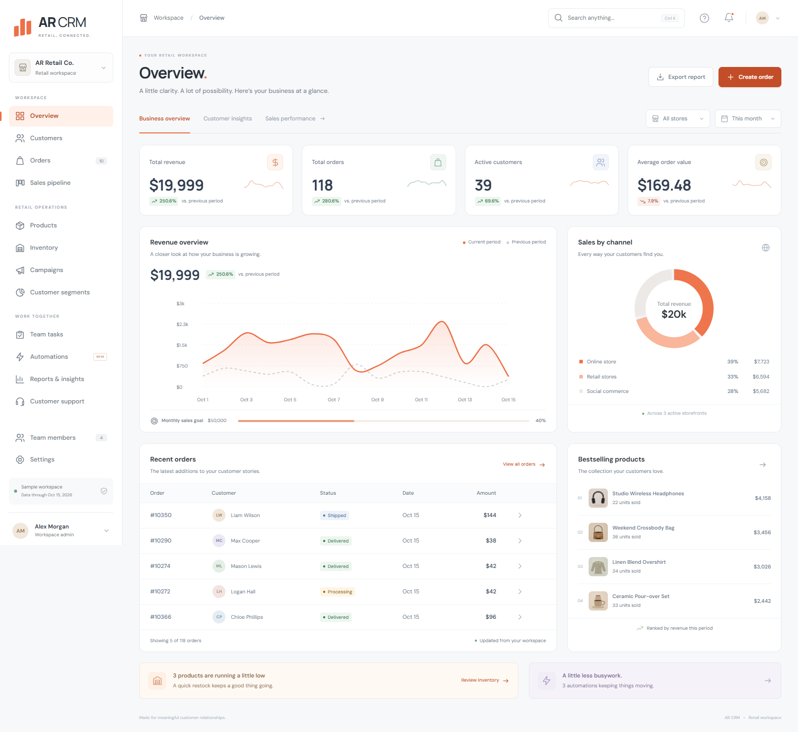
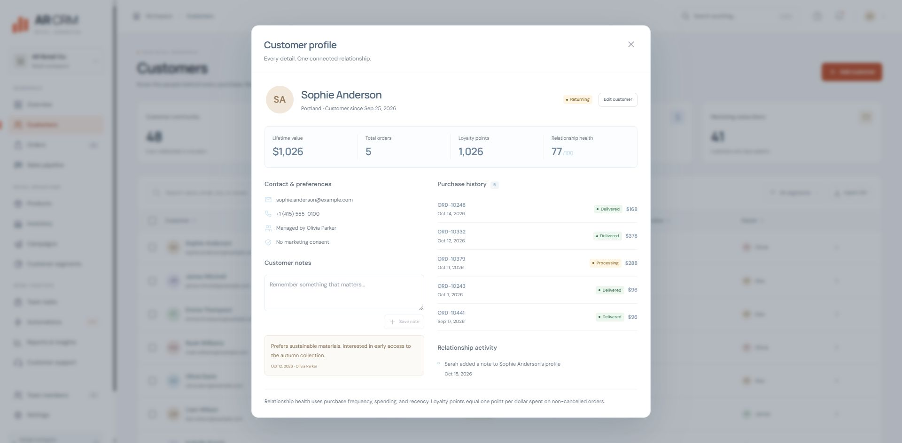
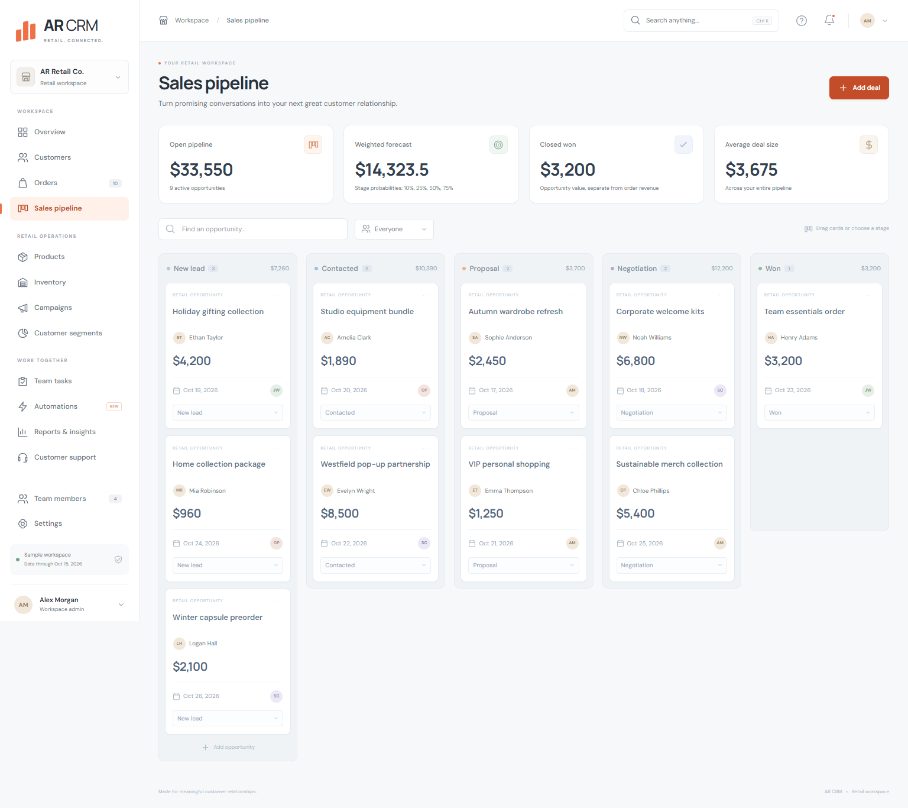
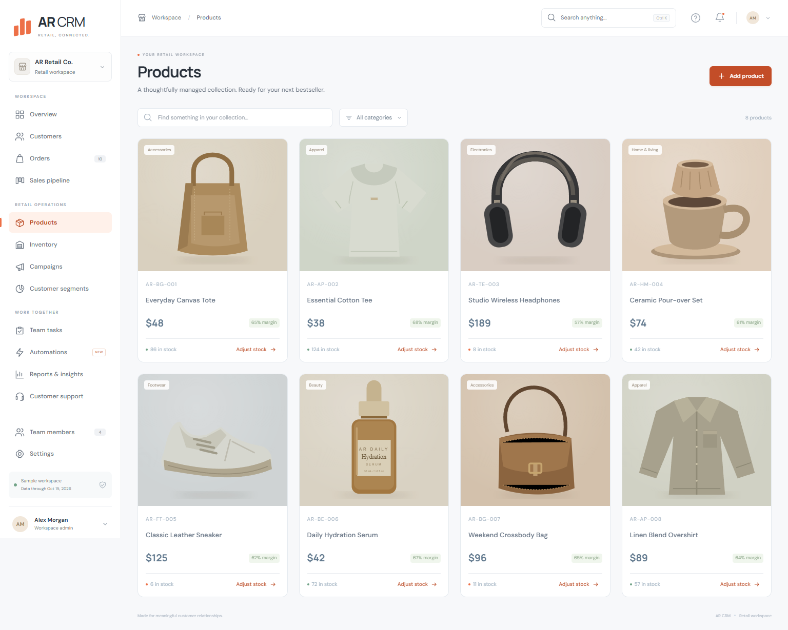
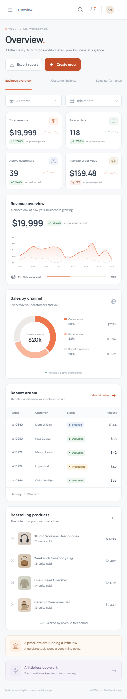

<p align="center"></p>

<h1 align="center">AR CRM</h1>
<p align="center"><strong>Retail, connected.</strong><br>Customer relationships, retail operations, and your next opportunity — in one open-source workspace.</p>

<p align="center">
  <a href="LICENSE"></a>
  
  
  
</p>



AR CRM is an English retail CRM with a responsive interface, connected workflows, and fictional sample data. It is a working local demonstration and an extensible starting point for developers and retail teams.

**[Build guide](docs/BUILD.md) · [Contributing](CONTRIBUTING.md) · [Security and deployment status](SECURITY.md) · [MIT license](LICENSE)**

## Quick start

Use **Node.js 22 or newer** and npm. No API key, paid service, or database server is required.

```sh
git clone https://github.com/alirezarezaeei78/ar-crm.git
cd ar-crm
npm ci
npm run dev
```

Open **[http://localhost:3200](http://localhost:3200)**.

Sample data is generated automatically on first start. Changes are saved locally in `data/retail.json`. Product illustrations and fonts are bundled, so the interface does not depend on external image or font services.

## Build the optimized application

Stop the development server before building in the same checkout.

```sh
npm ci
npm run build
npm start
```

The optimized application also runs on port 3200. For test setup, alternate data locations, data resets, and troubleshooting, see the **[complete build guide](docs/BUILD.md)**.

## What you can do

| Workspace                | Included workflows                                                                                                         |
| ------------------------ | -------------------------------------------------------------------------------------------------------------------------- |
| **Overview**             | Revenue, orders, active customers, average order value, trend comparisons, channel mix, goals, and bestsellers             |
| **Customers**            | Create and edit profiles, record notes, view purchases and activity, track lifetime value, loyalty, consent, and ownership |
| **Sales pipeline**       | Drag opportunities through stages, filter by owner, and inspect weighted forecasts                                         |
| **Orders**               | Create orders with stock validation, update fulfillment, and cancel with automatic inventory restoration                   |
| **Products & inventory** | Edit product prices and costs, manage SKUs, adjust stock, and monitor reorder points                                       |
| **Customer segments**    | Dynamic VIP, Returning, New, and At risk groups derived from purchases                                                     |
| **Campaign planning**    | Save consent-aware audiences, budgets, drafts, and planned schedules; no email or SMS is sent                              |
| **Team tasks**           | Drag-and-drop boards, list views, priorities, due dates, owners, and customer links                                        |
| **Automations**          | Welcome, post-purchase, restock, and won-deal rules that create saved follow-up tasks                                      |
| **Reports**              | Gross profit, repeat purchase share, category performance, store comparisons, and CSV exports                              |
| **Support**              | Customer-linked tickets, priorities, and resolution tracking                                                               |
| **Team & settings**      | Team workload, customer ownership, workspace details, sales goals, and notification preferences                            |

Across the workspace: Ctrl/Cmd K search, sortable tables, pagination, bulk selection for exports, CSV formula-injection protection, keyboard focus, modal focus traps, responsive navigation, and reduced-motion support.

### Connected workflows, not isolated screens

1. Add a customer → an enabled welcome rule creates a task for their owner.
2. Create an order → stock decreases, customer spending and loyalty update, and a follow-up task can be created.
3. Reach a reorder point → an enabled restock rule creates work without duplicating open restock tasks.
4. Move a deal to Won → an enabled onboarding rule creates the next customer task.
5. Cancel an order → its units return to available inventory and its value leaves revenue and loyalty calculations.

## A closer look

### Customer relationships



### Sales opportunities



### Retail collection



<details><summary>View the mobile dashboard</summary>
<p align="center"></p>
</details>

## Verification

```sh
npm run build
npm run typecheck
npm audit
```

The browser suite covers **19 integration checks**, including saved customer notes and edits, duplicate email rejection, product editing, historical order costs, overselling prevention, cancellation stock restoration, automated tasks, pipeline transitions, drag-and-drop, campaign planning, support, settings, global search, CSV exports, and mobile layouts across all 14 screens.

Install the optional Python browser test dependencies once:

```sh
python -m pip install -r requirements-test.txt
python -m playwright install chromium
npm test
```

The test runner uses a fresh isolated dataset and port 3201, leaving saved workspace records untouched. Results and screenshots are written to `artifacts/`. GitHub Actions runs the build and browser suite on pushes and pull requests.

## Architecture

```text
app/
  [section]/page.tsx            Retail routes
  retail-actions.ts            Validated mutations and automation triggers
  globals.css                  Responsive visual system
components/
  retail-shell.tsx              Navigation, forms, dialogs, and customer profiles
  retail-workspace.tsx          Retail screens, tables, and interactions
  retail-charts.tsx             SVG revenue and channel charts
  retail-icons.tsx              Shared icon system
lib/
  retail-types.ts               Types, segments, formatting, and reporting logic
  retail-db.ts                  Atomic local JSON persistence
scripts/
  seed-retail.mjs               Reproducible fictional sample data
  run-retail-tests.mjs          Isolated browser-test runner
  test-retail.py                Browser integration checks
public/                        Local fonts and product illustrations
docs/                          Build instructions, screenshots, and launch assets
```

## Sample data and metric definitions

The sample contains **48 fictional customers, 8 products, 260 orders, 10 opportunities, and 4 team members**. Dates are anchored to **October 15, 2026** for a reproducible demonstration. Local records are excluded from Git and generated from the seed script.

- Revenue is the value of non-cancelled orders, not reconciled cash receipts.
- Gross profit subtracts the unit cost recorded at purchase. Tax, shipping, refunds, and operating expenses are not modeled.
- Previous-period comparisons use the same number of days. Active customers are distinct purchasers in the selected period.
- VIP means at least $1,800 in lifetime spending. Among remaining customers, At risk means no purchase in over 30 days, Returning means multiple recent purchases, and New covers everyone else.
- Loyalty awards one point per whole dollar spent on non-cancelled orders. Relationship health is a transparent rules-based indicator, not an AI prediction.
- Pipeline forecast probabilities are 10%, 25%, 50%, and 75% for New lead, Contacted, Proposal, and Negotiation. Won opportunity value is separate from order revenue.

## Deployment status and roadmap

This release uses **single-process local JSON persistence**. It does not include production authentication, multi-user authorization, a transactional database, payment processing, or email/SMS delivery. Campaign scheduling records a plan only.

Before a live deployment, implement the controls described in **[SECURITY.md](SECURITY.md)**. A writable filesystem is required; concurrent application instances and ephemeral serverless storage are not supported by this data layer.

Useful next contributions include:

- Transactional database adapters and migrations.
- Authentication, role enforcement, and tenant isolation.
- Import previews with validation and conflict handling.
- Payment/refund reconciliation and richer audit history.
- Consent-aware email/SMS delivery adapters.
- More assistive-technology and workflow coverage.

## Contributing

Issues, focused pull requests, and practical retail feedback are welcome. Start with **[CONTRIBUTING.md](CONTRIBUTING.md)**.

## License

AR CRM is open source under the **[MIT license](LICENSE)**. Bundled fonts retain their SIL Open Font License 1.1 terms; see **[THIRD_PARTY_NOTICES.md](THIRD_PARTY_NOTICES.md)**.

Created by [Alireza Rezaei](https://github.com/alirezarezaeei78).
